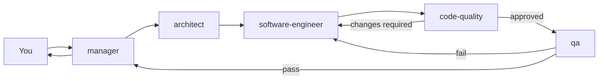

# AI workflow

Flowi ships a set of [Claude Code](https://claude.com/claude-code) agents and skills that take a feature from idea to tested code. They live in `.claude/` and follow the same conventions as the rest of this repo.

## Requirements

- Claude Code installed and logged in (`claude` available in your terminal).
- Dependencies installed with `pnpm install`.
- Playwright Chromium installed once for story tests: `pnpm exec playwright install chromium`.
- Optional: the Playwright MCP, used by QA for browser checks. QA explains how to install it if it is missing.

## Start the manager

```bash
pnpm manager
```

This runs `claude --agent manager`, a Claude Code session where the manager is the main agent. Describe what you want to build or fix. The manager asks the questions it needs, including the design for any visual change, and then runs the other agents for you.

> Always start feature work with `pnpm manager`. Running the manager from inside another session makes it a subagent, and subagents cannot call other agents.

## How it works



| Agent               | What it does                                                                           | Writes code     |
| ------------------- | -------------------------------------------------------------------------------------- | --------------- |
| `manager`           | Clarifies requirements, asks for designs, writes the spec, and runs the pipeline       | No              |
| `architect`         | Turns the spec into a short plan and blocks unnecessary abstractions                   | No              |
| `software-engineer` | Implements the plan with stories and tests                                             | Yes             |
| `code-quality`      | Reviews only the changed files and sends specific fixes back                           | No              |
| `qa`                | Runs the tests and checks the change in a Next.js consumer project (`flowi-next-test`) | Test files only |

QA creates `../flowi-next-test` next to this repo the first time, after asking you. It installs the packed library there and adds a playground page per feature. It keeps a record of passed checks in `.claude/qa-log/` (git-ignored), so later rounds only test what changed.

The manager never makes technical decisions: it plans the spec and a non-technical task breakdown, talks to you about product, design, and public-API choices, and sends every technical question or trade-off (including code-quality and QA findings) to the architect first.

Acceptance criteria are written to be measurable (values, tolerances, contrast), so the engineer tests them up front.

### Pitfalls file

`.claude/knowledge/pitfalls.md` lists project-specific pitfalls (symptom → rule). The architect, engineer, code-quality, and QA read it first. When code-quality or QA finds a new class of issue, it adds a `Pitfall:` line to its report and the engineer appends it to the file.

### Re-review

After a fix round, the engineer writes the round diff to `.claude/qa-log/<feature>-round-<n>.diff` (git-ignored). Code-quality then runs in re-review mode: it checks only the previous issues and the new diff lines, without rereading `CLAUDE.md` or approved code. Minor suggestions go into the same fix round as the required fixes.

## Skills

Run these inside any Claude Code session in this repo:

| Skill     | What it does                                                                       |
| --------- | ---------------------------------------------------------------------------------- |
| `/commit` | Creates small Conventional Commits with a scope and body. Refuses to run on `main` |
| `/pr`     | Pushes the branch and opens a PR from `.github/pull_request_template.md`           |
| `/docs`   | Updates every doc affected by the current changes                                  |

The manager suggests these when the pipeline finishes. Commits and PRs carry no AI attribution.
